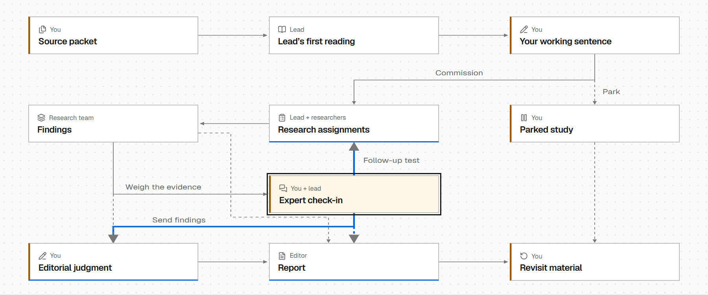

# ResearchChain

ResearchChain is a local workbench for financial research. Bring a week of charts, releases, and conversations. Turn one observation into a working thesis, send researchers to test competing explanations, and decide what belongs in the report.

[Run locally](#run-locally) · [Follow a study](#follow-a-study) · [Build a workflow](#build-a-workflow) · [Documentation](docs/README.md)


_Two leads are investigating the same rally. Selecting a researcher opens its current pass alongside the rest of the team. All screenshots use synthetic material._

## Run locally

You’ll need Git, Node.js 24, uv 0.12.5 or later, and Docker with Compose. Start Docker before running these commands.

```sh
git clone https://github.com/andersj05/ResearchChain.git
cd ResearchChain
npm install --global pnpm@11.24.0
pnpm bootstrap
pnpm db:up
pnpm db:migrate
pnpm dev
```

Leave the development server running. In a second terminal in the same directory, run `pnpm access:login` to get your private sign-in link. Open the workbench at `http://127.0.0.1:3000`.

**For a first look**, open **Workflows → Use no-model demo** to try a local run and its review checkpoint. For a live research study, connect an eligible ChatGPT plan and set up the analyst tools. [Development setup](docs/development.md) · [Owner sign-in](docs/owner-access.md) · [Research provider](docs/chatgpt-plan.md)

## Follow a study

Suppose the index rose but the median stock barely moved. Was the rally concentrated in a few companies, or did sector weights make it look that way?

1. **Pin the packet.** Add the dated chart, the underlying release, and the conversation that prompted the question. The lead’s first reading cites the material and suggests a working sentence. Edit it, commission it, or park it.
2. **Test rival explanations.** One lead can compare cap-weighted and equal-weight returns while another checks participation within sectors. In the live workspace, select an assignment to inspect its findings, model passes, and saved files.
3. **Give the team a judgment.** Each lead checks in by default. If sector composition is the issue, ask for a within-sector comparison. Your answer travels with the follow-up work.
4. **Write the bottom line.** Review the findings before the editor drafts. Trace a chart or claim back to its source, qualify what the evidence supports, and save a new report revision.



Open **Methodology** in the app to select a step and follow its handoffs. [Research Desk guide](docs/research-sessions.md) · [Evidence and provenance](docs/evidence-desk.md) · [Report editing](docs/reports.md)

## Build a workflow

Start with a blank canvas. Add a model prompt, insert a human review, then wire both the first draft and the reviewer’s feedback into a revision step. Save a version and run it. **Iterate from this run** starts the next experiment with the original workflow and inputs available for comparison.


[Build your first agent](docs/agent-builder.md) · [Canvas and workflow controls](docs/workflow-editor.md) · [Compare experiments](docs/evaluations.md)

## Inside the repository

| Location                                 | What you’ll find                                                                                                  |
| ---------------------------------------- | ----------------------------------------------------------------------------------------------------------------- |
| [apps/web](apps/web)                     | The Next.js and TypeScript interface, from the Research Desk to the visual workflow canvas.                       |
| [apps/api](apps/api)                     | FastAPI endpoints, workflow validation, LangGraph execution, and the worker that saves checkpoints in PostgreSQL. |
| [packages/contracts](packages/contracts) | The generated OpenAPI contract and TypeScript types shared with the frontend.                                     |
| [examples](examples)                     | Shareable workflows and synthetic research inputs.                                                                |
| [docs](docs/README.md)                   | Guides for researchers, contributors, and people running the workbench.                                           |

**Contributing.** Start a feature branch from `dev` and open a PR back to `dev`. Tested releases reach `main` through a promotion PR. Use synthetic examples in public issues, screenshots, and test fixtures. [Contribution guide](CONTRIBUTING.md) · [Architecture](docs/architecture.md) · [Issues](https://github.com/andersj05/ResearchChain/issues)

This repository is public and currently has no project license.
