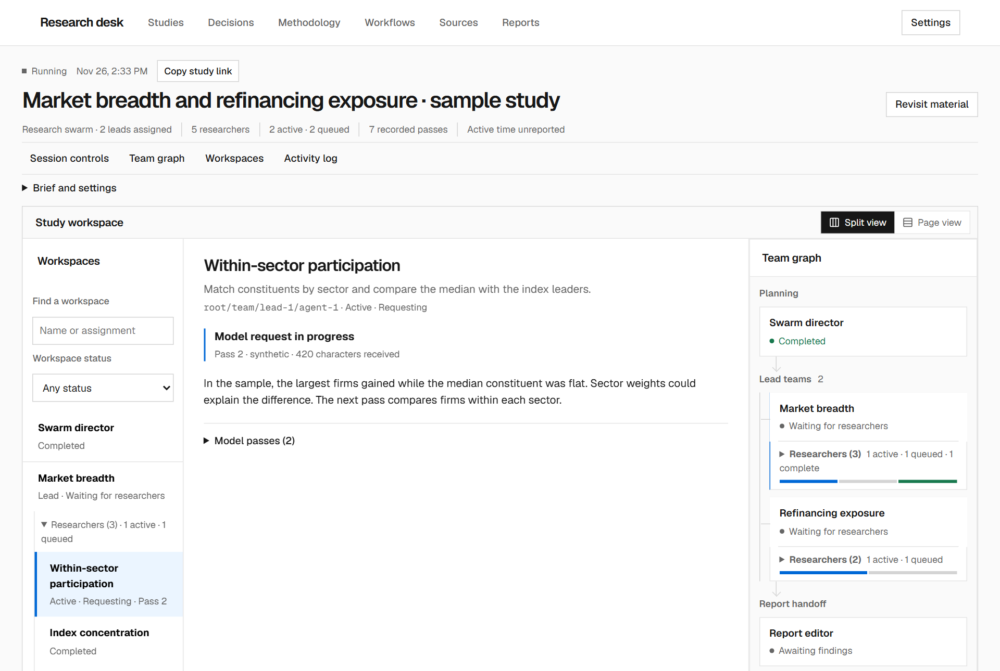
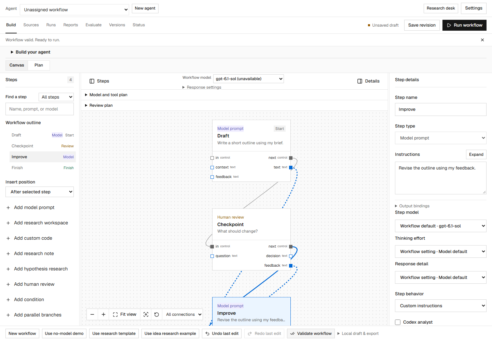

# ResearchChain

[](https://github.com/andersj05/ResearchChain/actions/workflows/ci.yml?query=branch%3Amain+event%3Apush)
[](.node-version)
[](apps/api/pyproject.toml)
[](package.json)
[](compose.yaml)

ResearchChain is a local workbench for financial research. On the **Research Desk**, start with a chart, release, or conversation, ask agents to test competing explanations, and decide which findings belong in a report. In **Workflows**, build your own agent by choosing its instructions, sources, and human review steps.

[Run locally](#run-locally) · [Follow a study](#follow-a-study) · [Build a workflow](#build-a-workflow) · [Browse the docs](docs/README.md)



_Two leads investigate the same rally. Selecting a researcher shows the comparison it is running and the files behind it. All screenshots use synthetic material._

## Run locally

Install Git, Node.js 24, and uv 0.12.5 or later. Start Docker with Compose enabled. The setup uses uv to install Python 3.12 if needed and Docker to run PostgreSQL.

```sh
git clone https://github.com/andersj05/ResearchChain.git
cd ResearchChain
npm install --global pnpm@11.24.0
pnpm bootstrap
pnpm db:up
pnpm db:migrate
pnpm dev
```

Leave `pnpm dev` running. In a second terminal in the same directory, run `pnpm access:login`. It opens a private, single-use sign-in link in your browser. The workbench runs at `http://127.0.0.1:3000`. [Setup guide](docs/development.md) · [Sign-in help](docs/owner-access.md)

### Try the no-model demo

This local workflow runs without a model account or API key.

1. Open **Workflows** and select **Use no-model demo**.
2. Choose **Run workflow**. Keep the sample research brief or enter your own, then select **Start run**.
3. When the run shows **Needs review**, inspect **Frame the question** and **Challenge the thesis**. Choose **Approve and continue** to finish the run.

For live research, connect an eligible ChatGPT plan and set up the worker’s analyst tools. [ChatGPT connection](docs/chatgpt-plan.md) · [Analyst setup](docs/development.md#desktop-delivery)

## Follow a study

The index rose, but the median stock barely moved. Did a few large companies drive the rally, or did the index have more weight in sectors that rose? Here’s how you could investigate that question on the Research Desk.

1. **Pin the evidence.** Add the dated chart, the underlying release, and the conversation that raised the question. Ask the lead for a first reading. Follow its citations and edit the proposed working sentence before assigning research.
2. **Test both explanations.** Ask one lead to compare cap-weighted and equal-weight returns. Ask another to check how many stocks rose within each sector. Open an assignment to inspect the researcher’s calculations and saved files.
3. **Guide the next test.** Each lead checks in by default. If one semiconductor stock dominates the result, ask the team to repeat the comparison without it. The lead receives your answer before it continues.
4. **Decide what to report.** Review what the evidence supports before the editor drafts. Open **Edit in Reports** to qualify a claim, trace a figure to its source, and save a revision. You can export the report with its figures and captured sources for offline review.

<details>
<summary>View the study methodology</summary>


Open **Methodology** in the app to select a step and follow its handoffs.

</details>

[Research Desk guide](docs/research-sessions.md) · [Evidence and provenance](docs/evidence-desk.md) · [Report editing and export](docs/reports.md)

## Build a workflow

In **Workflows → New agent**, start with a blank graph. For a thesis-review agent, add a model prompt to draft the thesis, a human review to record your objection, and a second prompt to revise the draft. Connect the first prompt’s text and the reviewer’s feedback to the revision step so it receives both.

Choose the model, sources, and execution limits for your experiment. Save a revision and run it. **Iterate from this run** restores the workflow and inputs into the editor so you can change one instruction, run it again, and compare the two outputs.



[Build your first agent](docs/agent-builder.md) · [Try the editable idea-research example](docs/idea-research-example.md) · [Compare experiments](docs/evaluations.md)

## Inside the repository

| Location                                 | What you’ll find                                                                                                  |
| ---------------------------------------- | ----------------------------------------------------------------------------------------------------------------- |
| [apps/web](apps/web)                     | The Next.js and TypeScript interface, from the Research Desk to the visual workflow canvas.                       |
| [apps/api](apps/api)                     | FastAPI endpoints, workflow validation, LangGraph execution, and the worker that saves checkpoints in PostgreSQL. |
| [packages/contracts](packages/contracts) | The generated OpenAPI contract and TypeScript types shared with the frontend.                                     |
| [examples](examples)                     | Shareable workflows and synthetic research inputs.                                                                |
| [docs](docs/README.md)                   | Guides for researchers, contributors, and people running the workbench.                                           |

[Architecture](docs/architecture.md) · [Workflow editor reference](docs/workflow-editor.md) · [Documentation index](docs/README.md)

## Contributing

Branch from `dev` and open a pull request back to `dev`. Use synthetic examples in public issues, screenshots, and test fixtures. CI checks formatting, lint, types, the API contract, the production build, and backend and browser tests. [Contribution guide](CONTRIBUTING.md) · [Issues](https://github.com/andersj05/ResearchChain/issues)

This repository is public and currently has no project license.
