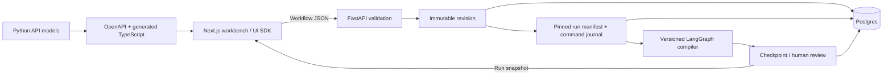

# Architecture

The workflow document is the editing boundary. The server validates node IDs,
connections, supported node kinds, reachability, termination, and budgets. A run
receives its own immutable workflow snapshot; edits affect future runs only.
Layout coordinates never determine execution order.

## Foundation boundary

The first runtime supports a single connected chain of note, review, and finish
nodes. Notes record user-provided text; review uses a real LangGraph interrupt;
finish marks completion. These are development behaviors, not research agents.
The graph is compiled from the submitted document, not a separate hardcoded flow.

Postgres stores content-deduplicated revisions, immutable run inputs, command
receipts, and LangGraph checkpoints. Each run is reconstructed from its pinned
revision and compiler version. Session advisory locks serialize execution across
API processes; a worker losing its lock connection also loses checkpoint write
access. Each graph step uses synchronous persistence, without a transaction held
across the invocation. The journal bridges the gap between accepted commands,
checkpoint writes, and HTTP acknowledgements. See [ADR 0002](decisions/0002-durable-runs.md).

Resume requests address the exact checkpoint and interrupt; retries cannot approve
a later review. An unfinished command is exposed as `interrupted` and recovered
through an explicit POST. The system does not run background recovery on startup.
External effects in future tool nodes will still require their own idempotency
keys; checkpoints alone do not provide exactly-once network side effects.

Artifact references use content addresses (`sha256:<digest>`) in the manifest;
graph state contains only those IDs. The evidence desk stores bounded immutable
originals in Postgres, records provenance and claim relationships, and pins selected
evidence versions to a run. New inputs are checked against captured bytes; accepted
legacy manifests remain compatible. A valid hash establishes content identity, not
source correctness. See [evidence desk](evidence-desk.md) and
[ADR 0004](decisions/0004-evidence-provenance.md).

The service binds to loopback and has no authentication. Browser drafts remain
optional local convenience copies; saved revisions and runs live in Postgres.
Keep this development service private to the local machine.

Schema 0.2 adds typed structured control flow, qualified subgraph/loop invocation
paths, parallel reviews, durable execution budgets, and cancellation. Its compiler
is separate from the preserved v0.1 executor. See [structured workflows](structured-workflows.md)
and [ADR 0003](decisions/0003-structured-workflows.md) for semantics and limits.

## Next capabilities

- Add background execution, retention, quotas, and backups before long-running
  or multi-user use. The visual editor and durable cancellation are implemented.
- Build on source provenance and claim relationships to test hypotheses, record
  falsifiers and confidence, and trace numerical assertions into report prose.
- Put research/retrieval, synthesis, drafting, and editing behind independently
  testable node interfaces. Model keys and tool credentials remain server-side.
- Bound run cost, time, iterations, and concurrent tools. Instrument actual node
  events and artifacts, not hidden reasoning transcripts.
- Keep the graph editor, evidence desk, run inspector, and report/feedback views
  distinct. A giant canvas alone is not a usable research workspace.

The visual editor will define workflows rather than reverse-engineer arbitrary
Python source. Advanced code can become a registered, typed node with a deliberate
input/output interface; it is not submitted as executable code from the browser.
