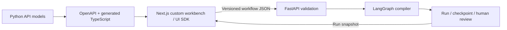

# Architecture

The workflow document is the editing boundary. The server validates node IDs,
connections, supported node kinds, reachability, termination, and budgets. A run
receives its own immutable workflow snapshot; edits affect future runs only.
Layout coordinates never determine execution order.

## Foundation boundary

The first runtime supports a single connected chain of note, review, and finish
nodes. Notes record user-provided text; review uses a real LangGraph interrupt;
finish marks completion. These are development behaviors, not research agents.
The graph is compiled from the submitted document, not a separate hardcoded flow.

Runs and checkpoints are local process memory. Restarting the API discards them.
The service binds to loopback and has no authentication. Browser drafts are local
to the browser; export workflow JSON for portability. Do not expose this service
publicly or use it as the durable store for research.

## Next capabilities

- Add durable Postgres checkpoints, immutable workflow revisions, run manifests,
  and artifact storage before long-running or multi-user use.
- Add bounded conditional loops, explicit parallel joins, typed ports, subgraphs,
  and cancellation to both the schema and compiler, with execution tests.
- Track evidence source URL, retrieval time, publication time, as-of date, content
  hash, permission, and excerpt/chart location. Keep screenshots distinct from data.
- Store claims, support, contradictions, hypotheses, falsifiers, and confidence
  separately from report prose. Make every important numerical assertion traceable.
- Put research/retrieval, synthesis, drafting, and editing behind independently
  testable node interfaces. Model keys and tool credentials remain server-side.
- Bound run cost, time, iterations, and concurrent tools. Instrument actual node
  events and artifacts, not hidden reasoning transcripts.
- Keep the graph editor, evidence desk, run inspector, and report/feedback views
  distinct. A giant canvas alone is not a usable research workspace.

The visual editor will define workflows rather than reverse-engineer arbitrary
Python source. Advanced code can become a registered, typed node with a deliberate
input/output interface; it is not submitted as executable code from the browser.
