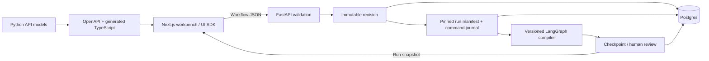

# Architecture

The workflow document is the editing boundary. The server validates node IDs,
connections, supported node kinds, reachability, termination, and budgets. A run
receives its own immutable workflow snapshot; edits affect future runs only.
Layout coordinates never determine execution order.

## Foundation boundary

The first runtime supports a single connected chain of note, review, and finish
nodes. Notes record user-provided text; review uses a real LangGraph interrupt;
finish marks completion. These are development behaviors, not research agents.
The graph is compiled from the submitted document, not a separate hardcoded flow.

Postgres stores content-deduplicated revisions, immutable run inputs, command
receipts, and LangGraph checkpoints. Each run is reconstructed from its pinned
revision and compiler version. Session advisory locks serialize execution across
API processes; a worker losing its lock connection also loses checkpoint write
access. Each graph step uses synchronous persistence, without a transaction held
across the invocation. The journal bridges the gap between accepted commands,
checkpoint writes, and HTTP acknowledgements. See [ADR 0002](decisions/0002-durable-runs.md).

Resume requests address the exact checkpoint and interrupt; retries cannot approve
a later review. An unfinished command is exposed as `interrupted` and recovered
through an explicit POST. The system does not run background recovery on startup.
External effects in future tool nodes will still require their own idempotency
keys; checkpoints alone do not provide exactly-once network side effects.

Artifact references use content addresses (`sha256:<digest>`) in the manifest;
graph state contains only those IDs. Artifact upload, byte storage, and availability
verification are not implemented yet. Never treat an asserted hash as evidence of
source availability or correctness.

The service binds to loopback and has no authentication. Browser drafts remain
optional local convenience copies; saved revisions and runs live in Postgres.
Keep this development service private to the local machine.

## Next capabilities

- Add artifact storage, background execution, cancellation, retention, and backups
  before long-running or multi-user use.
- Add bounded conditional loops, explicit parallel joins, typed ports, subgraphs,
  and cancellation to both the schema and compiler, with execution tests.
- Track evidence source URL, retrieval time, publication time, as-of date, content
  hash, permission, and excerpt/chart location. Keep screenshots distinct from data.
- Store claims, support, contradictions, hypotheses, falsifiers, and confidence
  separately from report prose. Make every important numerical assertion traceable.
- Put research/retrieval, synthesis, drafting, and editing behind independently
  testable node interfaces. Model keys and tool credentials remain server-side.
- Bound run cost, time, iterations, and concurrent tools. Instrument actual node
  events and artifacts, not hidden reasoning transcripts.
- Keep the graph editor, evidence desk, run inspector, and report/feedback views
  distinct. A giant canvas alone is not a usable research workspace.

The visual editor will define workflows rather than reverse-engineer arbitrary
Python source. Advanced code can become a registered, typed node with a deliberate
input/output interface; it is not submitted as executable code from the browser.
